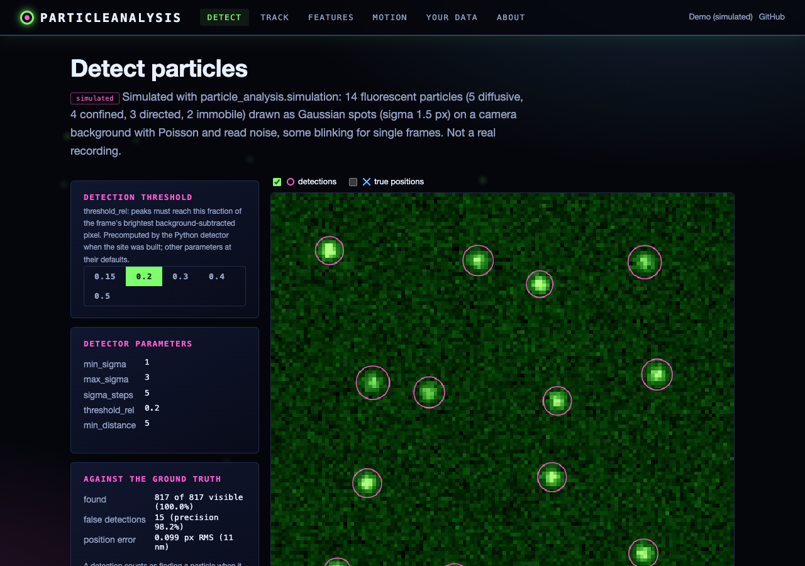
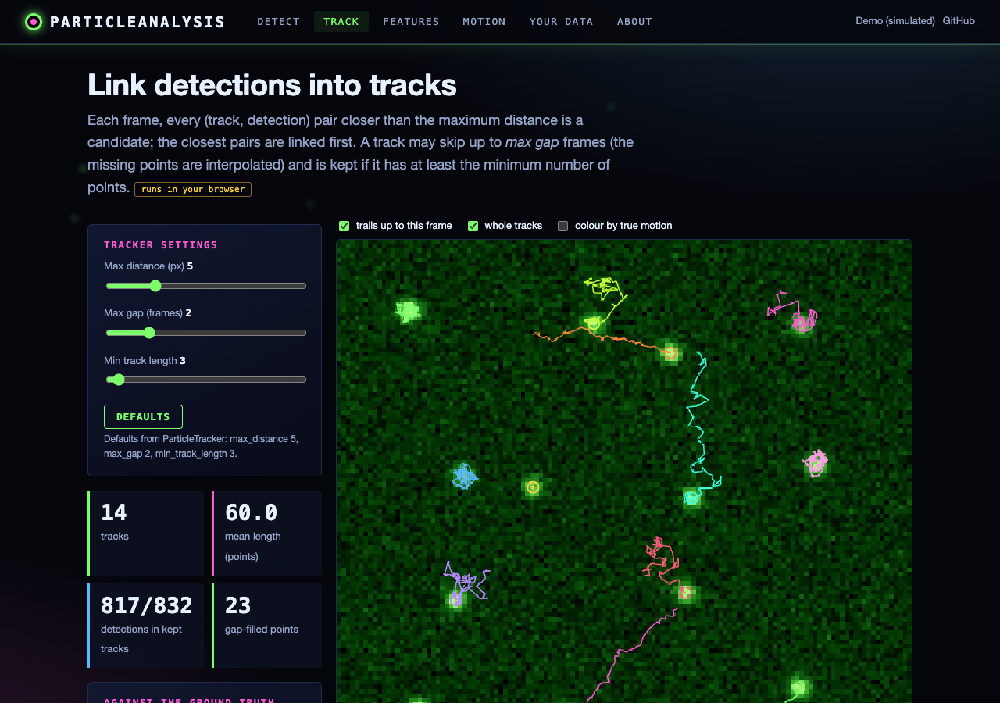
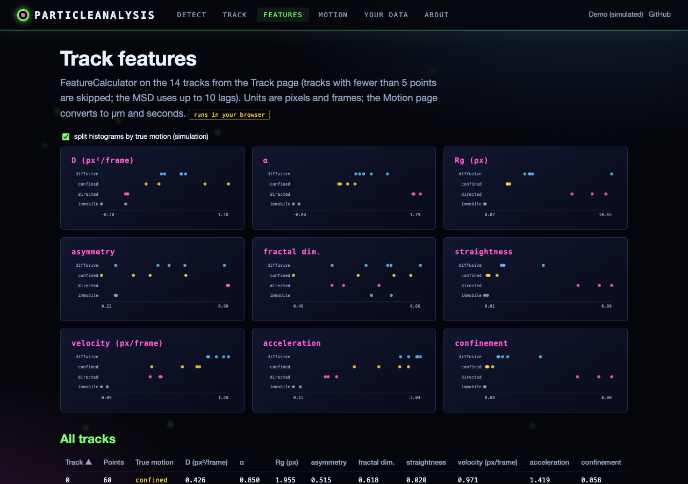
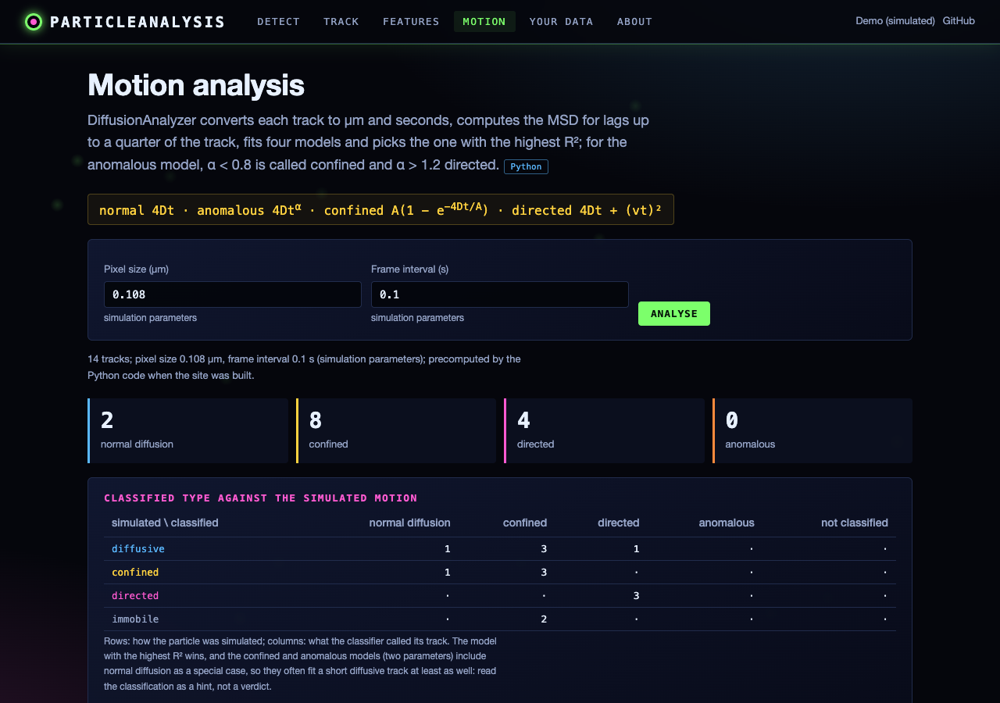

# ParticleAnalysis: A Python Tool for Single-Particle Tracking in Fluorescence Microscopy

## Overview

ParticleAnalysis is an open-source Python application for detecting, tracking, and analyzing fluorescent particles in microscopy image sequences. It provides a user-friendly graphical interface for analyzing single-particle dynamics, with particular emphasis on robust particle detection, reliable tracking, and comprehensive motion analysis.

## Key Features

- **Advanced Particle Detection**
  - 2D Gaussian fitting for sub-pixel positions (single scale: `max_sigma` sets the fit window;
    `min_sigma` and `sigma_steps` are stored but not used by the detector)
  - Local background subtraction and noise estimation
  - SNR of every detection, with SNR filtering in the analysis dashboard
  - Interactive ROI selection and parameter tuning

- **Robust Particle Tracking**
  - Nearest-neighbor linking algorithm with gap closing
  - Support for particle disappearance and reappearance
  - Track quality control and filtering
  - Visualization of tracking results

- **Comprehensive Motion Analysis**
  - Mean Square Displacement (MSD) analysis
  - Diffusion coefficient calculation
  - Motion type classification (confined, normal, directed, anomalous)
  - Track shape analysis (radius of gyration, asymmetry, fractal dimension)

- **User-Friendly Interface**
  - Interactive visualization of particles and tracks
  - Real-time parameter adjustment
  - Results tables with sorting and filtering
  - Batch processing capabilities

## Installation

```bash
# Create a new conda environment
conda create -n particle_analysis python=3.11
conda activate particle_analysis

# Install dependencies
pip install -r requirements/requirements.txt

# Install the package
pip install .
```

## Quick Start

1. Launch the application:
```bash
python -m particle_analysis
```

2. Load data:
   - Click "Open File" to load a TIFF stack
   - Adjust contrast using the histogram sliders
   - Select a region of interest (optional)

3. Detect and track particles:
   - Adjust detection parameters if needed
   - Click "Detect Particles" to identify particles
   - Click "Track Particles" to create trajectories
   - Or use "Analyze Full Image" for complete analysis

4. Analyze results:
   - View tracks in the Visualization tab
   - Examine feature distributions in the Analysis tab
   - Export results using File → Save Results

## Usage Examples

```python
# Programmatic usage
from particle_analysis.core import ParticleDetector, ParticleTracker
from particle_analysis.io import DataReader

# Load data
reader = DataReader()
movie = reader.read_movie('example.tif')

# Detect particles
detector = ParticleDetector(min_sigma=1.0, max_sigma=3.0)
particles = detector.detect_movie(movie)

# Track particles
tracker = ParticleTracker(max_distance=5.0, max_gap=2)
tracks = tracker.track_particles(particles)
```

## Technical Details

### Particle Detection

The detection algorithm fits a 2D Gaussian to each candidate spot:
1. Background estimation using median filtering
2. Local maxima detection above a threshold relative to the frame's brightest pixel (`threshold_rel`)
3. Sub-pixel localization through 2D Gaussian fitting
4. Quality control based on fit parameters

### Tracking Algorithm

Particle linking is performed using a nearest-neighbor approach with the following steps:
1. Frame-to-frame assignment: all (track, particle) pairs within `max_distance` (found with a KDTree), closest first
2. Gap closing for temporary disappearances
3. Track initialization and termination
4. Track quality filtering

### Motion Analysis

Track analysis includes:
- MSD calculation and curve fitting
- Diffusion coefficient estimation
- Anomalous diffusion exponent calculation
- Shape descriptors computation
- Motion type classification

## Web interface

A browser interface to the same pipeline, plus a static showcase on GitHub Pages
(https://gddickinson.github.io/particle_analysis/).

| Detect | Track |
|---|---|
|  |  |
| **Features** | **Motion** |
|  |  |

- **Detect**: the recording with ParticleDetector's detections, the threshold, per-frame counts and SNR/width histograms.
- **Track**: ParticleTracker with live settings, tracks drawn over the recording, a track table and CSV export.
- **Features**: FeatureCalculator (MSD fit, Rg, asymmetry, fractal dimension, straightness, ...) per track, CSV export.
- **Motion**: DiffusionAnalyzer's four MSD models and motion type, in µm and seconds.
- **Your data**: a TIFF stack (detected in Python by the local app; the pixel size is read from OME/ImageJ metadata
  when present) or a detections CSV (frame, x, y) tracked in the browser.

The demo recording is **simulated** by `particle_analysis/simulation.py` (14 particles: diffusive, confined, directed,
immobile; Gaussian spots with Poisson and read noise and blinking), so every page can compare its results with the true
particle paths. Detection and the motion analysis run in Python (precomputed for the demo on the static site); tracking
and track features run in the browser as JS ports that reproduce the Python output (`node
src/particle_analysis/web/static/engine.test.mjs`, fixture from `scripts/make_engine_fixture.py`).

### Run the web app

```bash
pip install -r requirements-web.txt
python run_web.py            # http://127.0.0.1:8129 (local only)
python -m pytest -q tests    # includes tests/test_web.py
python scripts/build_static.py --out site   # the static site, as published by .github/workflows/pages.yml
```

## Data Format

The application accepts:
- Input: TIFF stacks (.tif, .tiff)
- Output: CSV files containing:
  - Particle positions and intensities
  - Track coordinates and features
  - Analysis results

## Requirements

- Python 3.11 or later
- PyQt6
- NumPy
- SciPy
- pandas
- scikit-image
- scikit-learn
- matplotlib
- pyqtgraph

## Contributing

Contributions are welcome! Please see our [Contributing Guidelines](docs/contributing_guide.md) for details.


## License

This project is licensed under the MIT License - see the [LICENSE](LICENSE) file for details.

## Acknowledgments

- The scikit-image team for image processing algorithms
- The trackpy project for inspiration on particle tracking approaches
- The PyQt team for the GUI framework

## Contact

For questions and support:
- Open an issue on GitHub
- Email: george.dickinson@gmail.com
